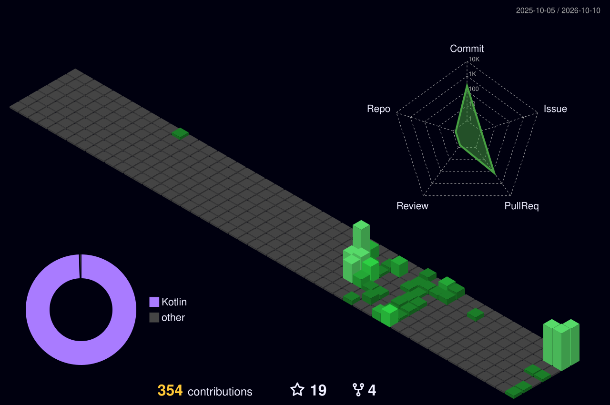

<div align="center">


<p>
  <a href="https://www.linkedin.com/in/bosankus/"></a>
  <a href="mailto:ankushbose5@gmail.com"></a>
  <a href="https://androidplay.in/"></a>
</p>


</div>

---

### 🧑‍💻 `whoami`

```kotlin
data class Ankush(
    val role: String = "Senior Android Engineer — Automotive",
    val experience: String = "9+ years",
    val basedIn: String = "Bengaluru, India 🇮🇳",
    val shipping: List<String> = listOf("Connected-car apps", "Banking apps", "KMP SDKs"),
    val currentlyBuilding: List<String> = listOf("Weatherify (KMP/CMP)", "Android Auto / AAOS module"),
    val askMeAbout: List<String> = listOf("Jetpack Compose", "Kotlin Multiplatform", "Clean Architecture"),
    val offDuty: String = "Brewing coffee & shaking cocktails ☕🍸",
)
```

---

### 🏆 Shipped at scale

| | Product | Impact |
|:-:|---|---|
| 🏦 | **HSBC UK Mobile Banking** | Android engineer on an app with **5M+ downloads** |
| 🚙 | **Stellantis connected-car app** (Jeep platform) | Android + **KMM SDK** in production, **1M+ downloads** |
| 📖 | **Wikipedia Android app** | Open-source contributor to Wikimedia Foundation |
| 🎓 | **Udacity** | Android Kotlin Developer certification |

---

### 🚀 Featured projects

<div align="center">
  <a href="https://github.com/bosankus/weatherify"></a>
  <a href="https://github.com/bosankus/transloom"></a>
</div>

- 🌦️ **Weatherify** — India-first hyperlocal weather app built with KMP/CMP, on-device AI, Wear OS on the way
- 🌐 **Transloom** — Gemini-powered app localization that auto-raises translated pull requests
- 🅿️ **Parking app** — KMP/CMP parking-spot finder with an Android Auto / AAOS car module

---

### 🛠️ Tech stack

<p align="center">
  
</p>

<p align="center">
  
  
  
  
  
  
  
</p>

---

### 📊 GitHub at a glance

<div align="center">
  
  
</div>

<div align="center">
  
</div>

<picture>
  <source media="(prefers-color-scheme: dark)" srcset="./profile-3d-contrib/profile-night-green.svg"/>
  <source media="(prefers-color-scheme: light)" srcset="./profile-3d-contrib/profile-green-animate.svg"/>
  
</picture>

---

<div align="center">

<picture>
  <source media="(prefers-color-scheme: dark)" srcset="https://raw.githubusercontent.com/bosankus/bosankus/output/github-snake-dark.svg"/>
  <source media="(prefers-color-scheme: light)" srcset="https://raw.githubusercontent.com/bosankus/bosankus/output/github-snake.svg"/>
  
</picture>

**⭐ If a repo helped you, a star goes a long way. Happy to talk Android, KMP, or anything automotive!**

</div>